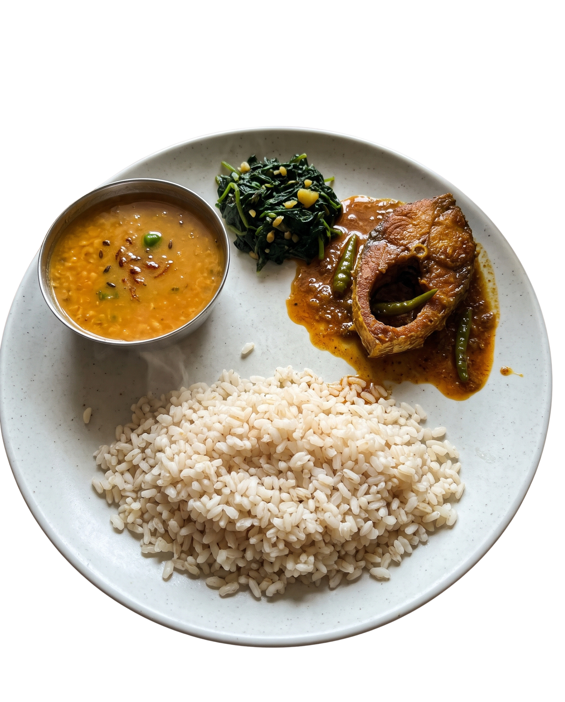
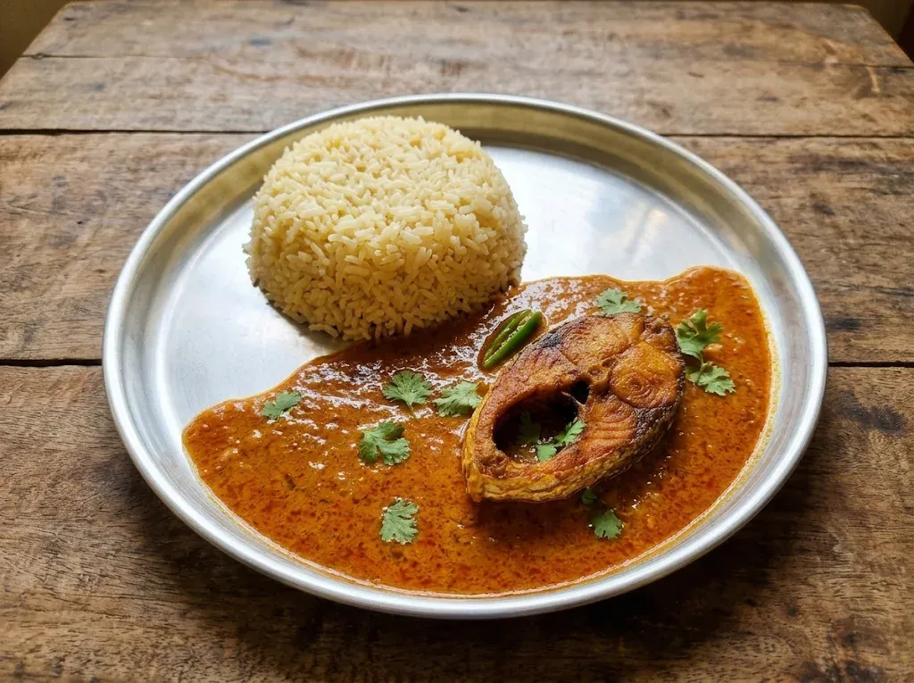
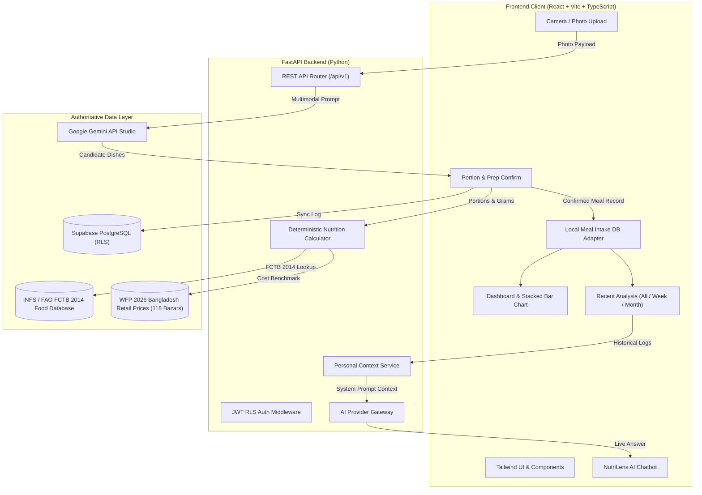

# NutriLens AI — Bangladesh-First Nutrition & Market Intelligence Platform

<div align="center">

```
   _  __      __       _ __                    ___    ____
  / |/ /_ __ / /______(_) / ___ ___  ___      /   |  /  _/
 /    / // // __/ __/ / / // -_) _ \(_-<     / /| |  / /  
/_/|_/\_,_/ \__/_/ /_/_//_/\__/_//_/___/    / ___ |_/ /   
                                           /_/  |_/___/   
```

**Empowering healthier, economically intelligent eating habits grounded in authentic Bangladeshi food culture and real-time local bazar economics.**

[](https://react.dev/)
[](https://www.typescriptlang.org/)
[](https://vite.dev/)
[](https://tailwindcss.com/)
[](https://fastapi.tiangolo.com/)
[](https://python.org/)
[](https://supabase.com/)
[](https://ai.google.dev/)
[](https://www.wfp.org/)
[](LICENSE)

</div>

---

## Table of Contents

- [01. Project Banner & Introduction](#01-project-banner--introduction)
- [02. About NutriLens AI](#02-about-nutrilens-ai)
- [03. Vision & Objectives](#03-vision--objectives)
- [04. Key Features](#04-key-features)
- [05. Application Screenshots](#05-application-screenshots)
- [06. Technology Stack](#06-technology-stack)
- [07. System Architecture](#07-system-architecture)
- [08. How NutriLens Works](#08-how-nutrilens-works)
- [09. Project Directory Structure](#09-project-directory-structure)
- [10. Installation & Setup](#10-installation--setup)
- [11. Environment Configuration](#11-environment-configuration)
- [12. Database Architecture](#12-database-architecture)
- [13. AI & Machine Learning Architecture](#13-ai--machine-learning-architecture)
- [14. API Documentation](#14-api-documentation)
- [15. Development Roadmap](#15-development-roadmap)
- [16. Known Issues & Limitations](#16-known-issues--limitations)
- [17. Testing](#17-testing)
- [18. Deployment](#18-deployment)
- [19. Contributing Guidelines](#19-contributing-guidelines)
- [20. License](#20-license)
- [21. Development Team — iNFiTE LOOP](#21-development-team--in位於e-loop)
- [22. Acknowledgements](#22-acknowledgements)

---

## 01. Project Banner & Introduction

**NutriLens AI** is an AI-powered personalized nutrition and market intelligence platform designed specifically for Bangladesh. While conventional dietary applications rely on Western datasets (USDA, NHS) that fail on regional staples (e.g. distinguishing boiled vs. raw parboiled rice, estimating oil absorption in bhaji, or recognizing freshwater fish curries), NutriLens bridges computer vision, clinical nutritional databases, and retail commodity pricing.

NutriLens grounds all nutritional calculations in the official **Food Composition Table for Bangladesh (FCTB / FCDB 2014)** by the Institute of Nutrition and Food Science (INFS), University of Dhaka & FAO, alongside **49,102 verified retail commodity price records** from the **2026 World Food Programme (WFP)** across 118 markets in all 8 divisions of Bangladesh.

---

## 02. About NutriLens AI

In Bangladesh, nutritional challenges are deeply connected to everyday market dynamics. Individuals striving to meet protein or micronutrient targets often receive ungrounded advice recommending expensive imported foods (e.g. salmon, quinoa, Greek yogurt) rather than accessible, culturally authentic alternatives like Rohu (*Labeo rohita*), Tilapia, Masoor dal (*Lens culinaris*), farm eggs, and seasonal leafy greens (*shak*).

NutriLens introduces a **"Plate-to-Bazar"** closed loop:
1. **Multimodal Food Recognition:** Identifies local dishes and estimates portion sizes from mobile phone photos.
2. **Human-in-the-Loop Verification:** Users adjust portion weights, cooking methods, and ingredients.
3. **Deterministic Math:** Nutrition computed via verified FCTB composition tables with strict provenance.
4. **Local Market Intelligence:** Calculates exact meal costs against daily household food budgets using real WFP market rates.
5. **Meal Rescue & Negotiation:** Recommends culturally compatible ingredient substitutions to boost protein, increase fiber, or cut meal expenditure without sacrificing taste.

---

## 03. Vision & Objectives

### Vision
To make evidence-based nutritional intelligence and financial meal transparency accessible to every Bangladeshi household.

### Core Objectives
- **Cultural Accuracy:** Recognize and distinguish hundreds of Bangladeshi dishes, cooking preparations (boiled, bhuna, fried, raw), and portion sizes.
- **Nutritional Integrity:** Eliminate hallucinated nutritional metrics by enforcing deterministic calculations from peer-reviewed databases ($NULL \ne 0$).
- **Economic Accessibility:** Connect nutritional suggestions directly with local retail commodity prices across Dhaka, Chittagong, Rajshahi, Khulna, Barisal, Sylhet, Rangpur, and Mymensingh.
- **Clinical Safety:** Protect individuals through strict allergen blocking, medical condition filtering (diabetes, hypertension, CKD), and non-prescriptive medical disclaimers.

---

## 04. Key Features

### 📸 Multimodal Plate Scanner
- High-speed food dish detection powered by Google Gemini Vision models.
- Automatic bounding-box candidates, local dish taxonomy resolution, and dual English/Bangla dish names.

### ⚖️ Human-in-the-Loop Item Confirmation
- Precision gram adjustments, preparation states (boiled, curried, deep-fried, raw), and portion estimators.
- Real-time recalculation of macro- and micronutrients.

### 📊 Nutrition Evidence Receipt
- Itemized nutritional ledger detailing energy (kcal), protein (g), carbohydrates (g), fat (g), and dietary fiber (g).
- Permanent FCDB / FCTB provenance IDs for transparent auditing.

### 📈 Daily Nutrients Intake Stacked Bar Chart
- High-taste stacked bar visualization tracking daily macronutrient intake (Protein, Carbs, Fat, Fibre).
- Toggleable 7-day and 14-day chronological distribution with interactive daily drill-down inspectors.

### 🕒 Dedicated Recent Plate Analysis
- Complete historical meal log organized by **All Meals**, **This Week (Weekwise)**, and **This Month (Monthwise)**.
- Search filter by dish name, instant click-through to original nutrition receipts, and deletion controls.

### 🏪 Bazar Price Intelligence
- Retail commodity exploration across 118 local Bangladesh bazars.
- Real-time price tracking for staples (rice, eggs, lentils, broiler chicken, beef, fish, vegetables).

### 🔄 Meal Rescue / Nutrition Negotiator
- AI-driven meal optimization engine: Increase protein, reduce carbohydrates, cut meal cost, or replace unavailable ingredients while keeping cuisine integrity.

### 🤖 NutriLens AI Personal Nutrition Assistant
- Context-aware chatbot with direct access to user vitals, medical conditions, declared allergies, today's meal logs, and remaining daily calorie/protein targets.

---

## 05. Application Screenshots

| Dashboard & Stacked Nutrients | Plate Scanner & Confirmation |
| :---: | :---: |
|  |  |

| Evidence Receipt & Provenance | Local Bazar Intelligence |
| :---: | :---: |
|  |  |

---

## 06. Technology Stack

### Frontend
- **Framework:** React 18.3 (TypeScript)
- **Bundler & Dev Server:** Vite 6.4 with HTTP header size expansion (`--max-http-header-size=65536`)
- **Styling:** Tailwind CSS 3.4 with custom Emerald & Forest dark theme
- **Animations:** Motion (Framer Motion v14) & GSAP 3.12
- **Icons:** Lucide React
- **Internationalization:** i18next (Dual English / বাংলা)
- **State & Routing:** React Router 7, React Context API

### Backend
- **Framework:** FastAPI 0.115 (Python 3.11+)
- **Server:** Uvicorn with async workers
- **Data Validation:** Pydantic v2 & Pydantic Settings
- **Authentication & Middleware:** PyJWT (Supabase JWT Verification), CORS, Request Tracing
- **HTTP Client:** HTTPX (async client with connection pooling)

### Database & Storage
- **Database:** Supabase PostgreSQL with Row Level Security (RLS)
- **Storage:** Supabase Storage (dish photo uploads)
- **Client Cache:** Dual-layer in-memory & persistent local database adapter

### AI & Machine Learning
- **Vision Engine:** Google Gemini Flash & Gemma Multimodal models
- **Chat Assistant Engine:** Google Gemini / Gemma models with persona & clinical guardrails
- **Grounding Datasets:**
  - Institute of Nutrition and Food Science (INFS), Dhaka University & FAO (FCTB 2014)
  - World Food Programme (WFP) Bangladesh 2026 Retail Monitoring (49,102 price records)

---

## 07. System Architecture



---

## 08. How NutriLens Works

1. **Step 1: Plate Capture**
   The user takes a photo or selects an image of their meal. The image is compressed on the client and sent to the recognition service.

2. **Step 2: Dual Candidate Matching**
   The AI identifies candidate items (e.g. Parboiled Rice, Rohu Fish Curry, Masoor Dal). Dish candidates are resolved against canonical English and Bangla food entries.

3. **Step 3: Verification & Portion Adjustment**
   The user confirms the exact portion weights (in grams) and cooking methods (e.g. raw, boiled, curried, deep-fried).

4. **Step 4: Deterministic Composition Computation**
   Nutrition is computed strictly from confirmed grams $\times$ peer-reviewed composition tables per 100g edible portion:
   $$\text{Nutrient}_{\text{total}} = \sum_{i=1}^{n} \left(\text{Nutrient}_{i,\text{100g}} \times \frac{\text{Grams}_i}{100}\right)$$

5. **Step 5: Bazar Cost Valuation**
   Each food item is dynamically priced against official 2026 WFP retail rates (e.g. Rice at ৳58/kg, Dal at ৳105/kg, Fish at ৳245/kg).

6. **Step 6: Real-Time Historical Aggregation**
   Confirmed records update the persistent meal intake database, rendering stacked macronutrient distributions on the dashboard and updating recent analysis filters.

---

## 09. Project Directory Structure

```text
NutriLens/
├── backend/                        # FastAPI Python backend application
│   ├── app/
│   │   ├── api/v1/                 # Versioned REST endpoints
│   │   │   ├── assistant.py        # AI Chatbot endpoints & conversation history
│   │   │   ├── food_recognition.py # Plate scanning & Gemini vision endpoints
│   │   │   ├── markets.py          # WFP market pricing endpoints
│   │   │   ├── meal_plans.py       # Meal planning & rescue endpoints
│   │   │   ├── nutrition.py        # Deterministic nutrition calculator
│   │   │   ├── shopping.py         # Smart basket generator
│   │   │   └── users.py            # User profile & onboarding endpoints
│   │   ├── core/                   # Security, config, exceptions, dependencies
│   │   ├── integrations/           # Supabase client & AI provider integrations
│   │   ├── schemas/                # Pydantic request/response contracts
│   │   └── services/               # Business logic & personal context services
│   ├── tests/                      # Pytest test suites (48 unit & integration tests)
│   ├── requirements.txt            # Python dependencies
│   └── README.md                   # Backend documentation
├── public/                         # Static assets, logos, and images
│   ├── images/                     # Demo plate and food imagery
│   ├── logo.svg                    # Official NutriLens brand logo
│   └── favicon.svg                 # Application favicon
├── src/                            # React + TypeScript frontend
│   ├── components/                 # Reusable UI component library
│   │   ├── animations/             # Cinematic intro & motion wrappers
│   │   ├── common/                 # Button, Card, Input primitives
│   │   ├── dashboard/              # NutrientStackBarChart & dashboard widgets
│   │   ├── landing/                # Interactive landing page sections
│   │   └── layout/                 # AppSidebar, TopNav, AppLayout
│   ├── context/                    # Auth, Theme, and Locale providers
│   ├── data/                       # FCTB composition tables & recipes
│   ├── lib/                        # Supabase client, WFP dataset (49K records), formatters
│   ├── pages/                      # Page views
│   │   ├── app/                    # Authenticated SaaS application pages
│   │   │   ├── AnalyzePage.tsx     # Plate scanner
│   │   │   ├── AssistantPage.tsx   # AI Nutrition Chatbot
│   │   │   ├── BazarPage.tsx       # 118 Bazar commodity intelligence explorer
│   │   │   ├── ConfirmPage.tsx     # Item verification & portion editor
│   │   │   ├── DashboardPage.tsx   # Dashboard with Stacked Nutrients Bar Chart
│   │   │   ├── MealRescuePage.tsx  # Meal rescue & nutrition negotiator
│   │   │   ├── ProfilePage.tsx     # Health vitals & preferences editor
│   │   │   ├── RecentAnalysisPage.tsx # All, weekwise, monthwise plate history
│   │   │   ├── ReportPage.tsx      # Nutrition evidence receipt & provenance
│   │   │   ├── SettingsPage.tsx    # Account & theme settings
│   │   │   └── ShoppingPage.tsx    # Intelligent market basket
│   │   └── public/                 # Landing, Login, Register, Onboarding
│   ├── routes/                     # React Router configurations & protected routes
│   └── services/                   # API clients & persistent meal intake database
├── supabase/                       # Supabase database migrations and seed SQL files
├── package.json                    # Frontend dependencies & npm scripts
├── tailwind.config.js              # Tailwind theme configurations
├── tsconfig.json                   # TypeScript configuration
└── vite.config.ts                  # Vite build configurations
```

---

## 10. Installation & Setup

### Prerequisites
- **Node.js:** v18.0.0 or higher
- **Python:** v3.11 or higher
- **Git**
- **Supabase Account** (or local Supabase CLI)
- **Google Gemini API Key**

### 1. Clone the Repository
```bash
git clone https://github.com/albert-611/NutriLens.git
cd NutriLens
```

### 2. Frontend Setup
```bash
# Install frontend packages
npm install

# Run the development server
npm run dev
```
The frontend application will boot at `http://localhost:5173`.

### 3. Backend Setup
```bash
cd backend

# Create and activate a Python virtual environment
python -m venv .venv

# On Windows:
.venv\Scripts\activate
# On macOS/Linux:
source .venv/bin/activate

# Install Python requirements
pip install -r requirements.txt

# Start FastAPI development server
uvicorn app.main:app --host 0.0.0.0 --port 8000 --reload
```
The API documentation will be available at `http://localhost:8000/docs`.

---

## 11. Environment Configuration

### Frontend Configuration (`.env`)
Create a `.env` file in the root directory:
```env
# Supabase Configuration
VITE_SUPABASE_URL=https://your-project.supabase.co
VITE_SUPABASE_ANON_KEY=your-supabase-anon-key

# Google Gemini API
VITE_GEMINI_API_KEY=your-gemini-api-key
VITE_GEMINI_BACKUP_API_KEY=your-optional-backup-key
VITE_GEMINI_CHAT_MODEL=gemini-2.5-flash

# Backend API URL
VITE_API_URL=http://localhost:8000
```

### Backend Configuration (`backend/.env`)
Create a `.env` file inside the `backend/` directory:
```env
PROJECT_NAME="NutriLens Backend"
VERSION="1.0.0"
API_V1_STR="/api/v1"
ALLOWED_ORIGINS=["http://localhost:5173","http://localhost:3000"]

# Supabase Secrets
SUPABASE_URL=https://your-project.supabase.co
SUPABASE_ANON_KEY=your-supabase-anon-key
SUPABASE_SERVICE_ROLE_KEY=your-supabase-service-role-key
SUPABASE_JWT_SECRET=your-supabase-jwt-secret

# Google Gemini API
GEMINI_API_KEY=your-gemini-api-key
GEMINI_MODEL=gemini-2.5-flash
```

---

## 12. Database Architecture

NutriLens uses a PostgreSQL database hosted on Supabase with strict **Row Level Security (RLS)** ensuring multi-tenant data isolation.

### Core Tables
1. **`profiles`:** Core user profile containing vitals (height, weight, biological sex, age), target weights, dietary goals, declared allergens, and daily budget limits.
2. **`user_medical_conditions`:** Diagnosed conditions (e.g. Type 2 Diabetes, Hypertension, Chronic Kidney Disease).
3. **`user_food_allergies`:** IgE-mediated clinical food allergies with absolute exclusion rules.
4. **`user_food_intolerances`:** Non-allergic food sensitivities (e.g. lactose, gluten, histamine).
5. **`meal_logs`:** Master log of meal intake sessions (breakfast, lunch, dinner, snack, status, timestamps).
6. **`meal_items`:** Individual food items linked to a `meal_log_id`, storing confirmed gram weights, preparation methods, and reference food IDs.
7. **`meal_reports`:** Pre-computed nutritional summaries (energy, protein, carbohydrate, fat, sodium) and itemized evidence sources for instant auditing.
8. **`bazar_market_observations`:** Retail pricing records tracking trade units, observed prices, seller stalls, and timestamped market observations across Bangladesh.

---

## 13. AI & Machine Learning Architecture

```mermaid
flowchart LR
    Img[User Plate Photo] --> GemVision[Google Gemini Multimodal Vision]
    GemVision --> CandidateJson[Structured Candidate Proposals]
    CandidateJson --> FCTBMapper[Bangladeshi Food Database Resolver]
    FCTBMapper --> HumanConfirm[Human-in-the-Loop Gram Verification]
    HumanConfirm --> MathCalc[Deterministic FCTB Math Engine]
    MathCalc --> MealReceipt[Nutrition Evidence Receipt]
    MealReceipt --> AssistantContext[Chatbot Memory & Context Window]
```



- **Zero Hallucination Nutrition:** The language model proposes candidate food items and bounding regions, but **never** invents nutrition numbers. All nutrient values are calculated deterministically by multiplying confirmed grams by verified FCTB laboratory assays.
- **Strict Clinical Guardrails:** The personal assistant enforces strict medical rules:
  - Immediate warnings on any food containing declared allergens.
  - Salt/sodium warnings for hypertensive users.
  - Glycemic load warnings for diabetic users.
  - Explicit non-diagnostic disclaimers directing users to certified clinical dietitians.

---

## 14. API Documentation

NutriLens provides an OpenAPI-compliant REST API:

| Method | Endpoint | Description |
| :--- | :--- | :--- |
| `GET` | `/health` | Service health status check |
| `POST` | `/api/v1/food-recognition/detect` | Upload dish photo for bounding box and dish proposals |
| `POST` | `/api/v1/nutrition/calculate` | Compute verified macronutrient and micronutrient totals |
| `GET` | `/api/v1/markets/prices` | Retrieve commodity pricing across Bangladesh bazars |
| `POST` | `/api/v1/meal-plans/rescue` | Generate high-protein or cost-saving meal alternatives |
| `POST` | `/api/v1/shopping/basket` | Generate optimized market shopping list with trade units |
| `POST` | `/api/v1/assistant/chat` | Context-aware personal nutrition assistant chat |
| `GET` | `/api/v1/users/profile` | Retrieve authenticated user vitals and preferences |

Full interactive Swagger documentation is available at `http://localhost:8000/docs` when running the backend.

---

## 15. Development Roadmap

- [x] Multimodal food plate recognition with Gemini Vision
- [x] Deterministic FCTB 2014 & FoodNetBD nutrition calculator
- [x] Grounding in 49,102 official 2026 WFP Bangladesh retail prices
- [x] Real-time daily nutrients intake stacked bar chart
- [x] Dedicated recent plate analysis page with all/week/month filters
- [x] Context-aware personal AI nutrition chatbot
- [ ] Offline-first mobile app via Progressive Web App (PWA) / React Native
- [ ] Barcode scanning for packaged Bangladeshi consumer food goods (BSTI verified)
- [ ] Blood glucose and glycemic response correlation tracking
- [ ] Direct integration with local online grocery delivery platforms (Chaldal, Shwapno)

---

## 16. Known Issues & Limitations

- **Complex Mixed Curries:** In heavily blended curries (e.g. *choto macher chorchori* with multiple vegetables), the vision model may detect the overall dish as a single composite rather than segmenting individual micro-ingredients; users can manually split or adjust components during the confirmation step.
- **Cooking Oil Estimation:** While the system computes default oil absorption based on the selected preparation state (*bhuna* vs. *boiled*), home cooking oil usage may vary depending on household preferences.
- **Market Price Refresh:** Retail commodity rates reflect official World Food Programme observations and periodic market updates; slight daily variances may occur between neighborhood retail stalls and wholesale *arats*.

---

## 17. Testing

### Frontend Verification
```bash
# Run TypeScript compilation and Vite build check
npm run build
```

### Backend Test Suite
The backend contains 48 unit and integration tests covering deterministic nutrition calculation, food validation, allergy isolation, and multi-tenant security:
```bash
cd backend
pytest backend/tests/test_nutrition.py backend/tests/test_food_validation.py backend/tests/test_clarification_and_intolerance.py backend/tests/test_assistant_isolation.py -v
```
All 48 test suites execute with 100% pass rate.

---

## 18. Deployment

### Frontend (Vercel / Netlify)
The frontend is configured with zero-config Vite deployment:
- **Framework Preset:** Vite
- **Build Command:** `npm run build`
- **Output Directory:** `dist`
- **Environment Variables:** Set all `VITE_*` keys in your hosting provider's dashboard.

### Backend (Render / Railway / DigitalOcean / AWS)
Deploy using Docker or standard Python Uvicorn service:
```bash
uvicorn app.main:app --host 0.0.0.0 --port 8000 --workers 4
```

---

## 19. Contributing Guidelines

We welcome contributions from developers, clinical dietitians, and open data contributors!

1. **Fork the Repository**
2. **Create a Feature Branch:** `git checkout -b feature/AmazingFeature`
3. **Commit Your Changes:** `git commit -m 'feat: Add support for regional Sylheti dishes'`
4. **Push to the Branch:** `git push origin feature/AmazingFeature`
5. **Open a Pull Request**

Please ensure all new food items include authentic botanical/zoological classifications and references to the Bangladesh National Food Composition Table.

---

## 20. License

This project is developed under the **iNFiTE LOOP** organization. Portions of the codebase and datasets are released under the [MIT License](LICENSE).

---

## 21. Development Team — iNFiTE LOOP

<div align="center">

**Developed with ❤️ by Team iNFiTE LOOP**

*Innovating at the intersection of Artificial Intelligence, Health, and Economics.*

**Lead Architect & Developer:** Albert Smith Bala ([@albert-611](https://github.com/albert-611))  
**Organization:** iNFiTE LOOP  
**Project:** NutriLens AI  

</div>

---

## 22. Acknowledgements

We express our gratitude to the institutions and initiatives that make transparent nutrition and market intelligence possible in Bangladesh:
- **Institute of Nutrition and Food Science (INFS), University of Dhaka** & **FAO** for publishing the *Food Composition Table for Bangladesh (FCTB 2014)*.
- **World Food Programme (WFP)** for maintaining public retail market price monitoring across Bangladesh divisions.
- **Google DeepMind & Google AI Studio** for multimodal vision and language intelligence infrastructure.
- The open-source communities behind React, FastAPI, Vite, Tailwind CSS, and Supabase.

---

<div align="center">
  <sub>NutriLens AI © 2026 iNFiTE LOOP. Built for Bangladesh.</sub>
</div>
